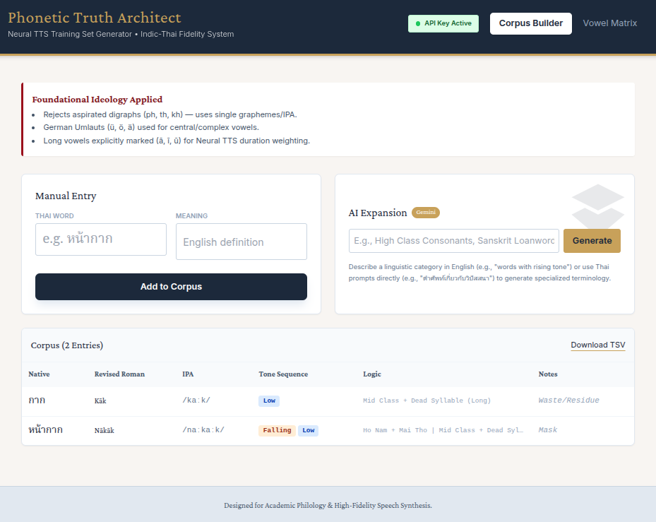
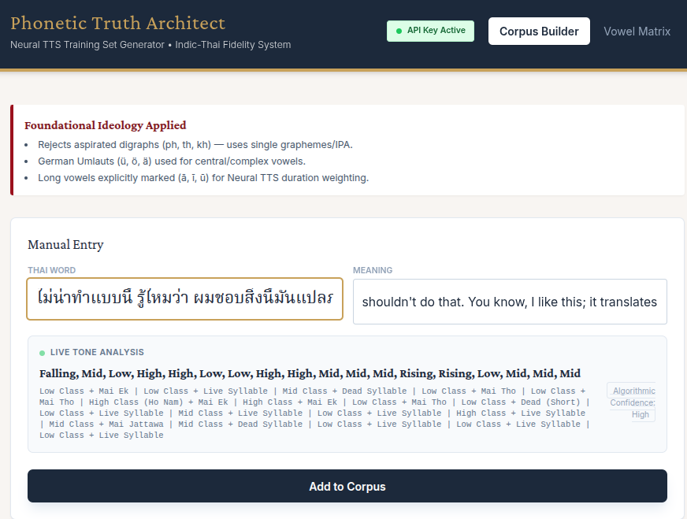

   <h2>Neural TTS Training Set Generator • Indic-Thai Fidelity System</h2>

A specialized linguistic workbench designed for building high-fidelity Neural TTS training datasets for Thai, Sanskrit, and Indic languages. The application features a deterministic "Self-Knowing" Tone Engine that algorithmically calculates lexical tones (Low, Mid, High, Falling, Risin

   

## Live Tone Analyst feature
- **Analyzes and interprets the tonal inflection**:
--

   

## Run Locally

**Prerequisites:**  Node.js

1. Install dependencies:
   `npm install`
2. Set the `GEMINI_API_KEY` in [.env.local](.env.local) to your Gemini API key
3. Run the app:
   `npm run dev`

## Phonetic Truth Architect V.0.01

Please play with the app and make some comments to me for improvements or changes or bug-fixes etc.. or ideas to enhance and improve this super-complex, in fact, monumental mission. to make Thai, Pali, and Sanskrit and other Monosyllabic and/or Tonal based languages into text to speech compatiblity. So AI reads aloud fluently, instead of like an idiot. This would permit Pali Maghada Sanskrit texts and Buddhist texts such as the Tipitaka Buddhist Canon, to be made into narrated podcasts and other forms of media accurately.
# Made with Google AI Studio

